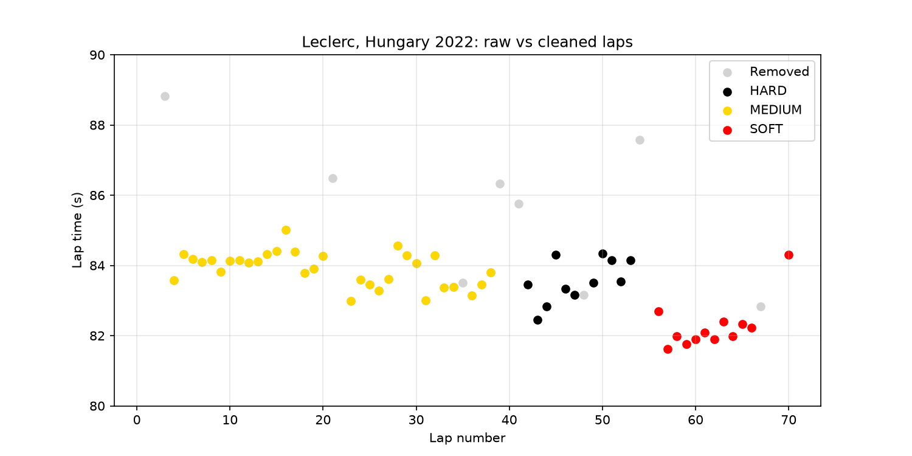
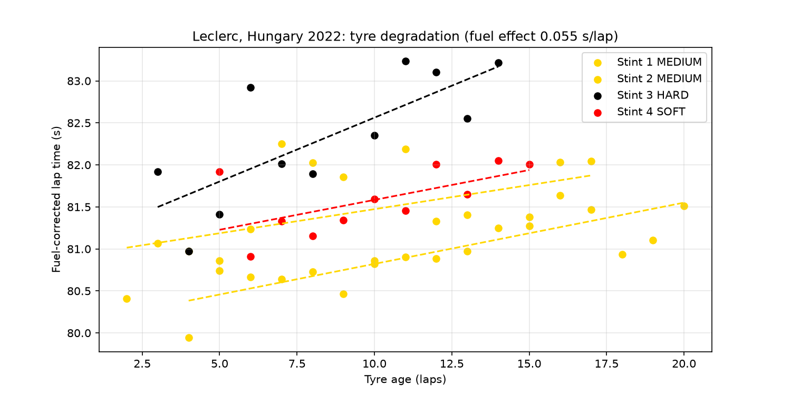
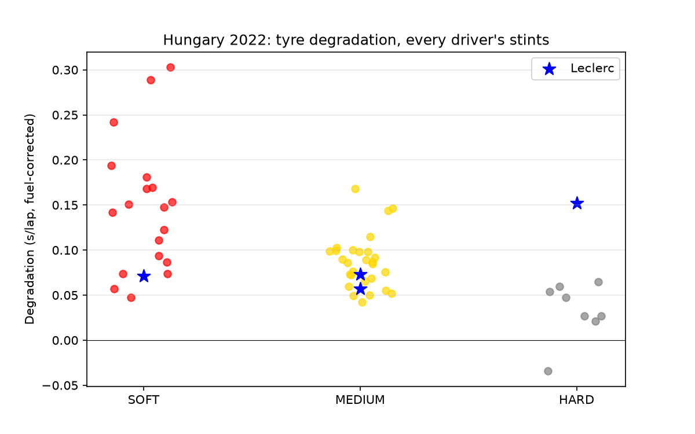
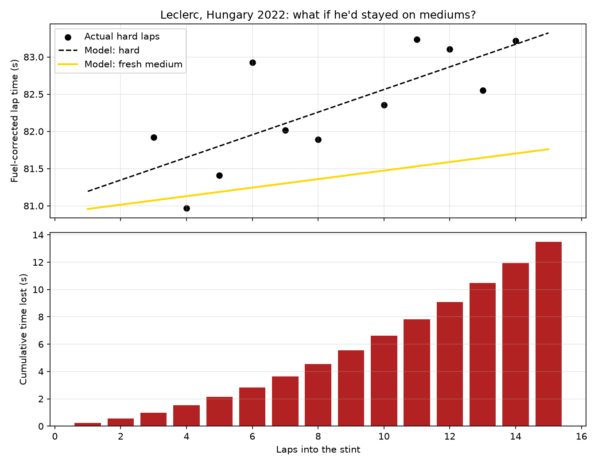
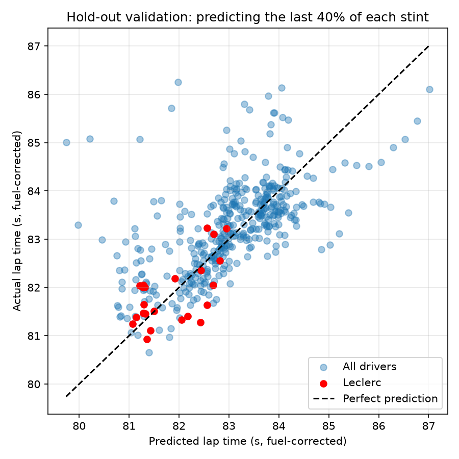

# Did the hard tyre cost Leclerc the 2022 Hungarian GP?

A Python analysis of real Formula 1 timing data (via [FastF1](https://github.com/theOehrly/Fast-F1)) testing whether Ferrari's decision to fit hard tyres to Charles Leclerc at the 2022 Hungarian Grand Prix cost him the race result.

## Key findings

- **Leclerc's hard stint degraded at 0.152 ± 0.044 s/lap, about 3× the field median on hards (0.047 s/lap, 9 stints).** On mediums and softs he was at or below the field median, so the hard tyre itself wasn't the problem, but it was for Leclerc.
- **Fresh mediums would have been 7–20 s faster over the 15-lap stint**, depending on the assumed fuel effect. About 11 s of this comes from degradation alone and does not depend on the fuel assumption.
- **A lap-by-lap race simulation with an overtaking threshold puts Leclerc between P1 and P4 instead of his actual P6** across all 12 combinations of fuel effect (0.03–0.08 s/lap) and overtaking difficulty (0.5–2.0 s/lap) tested. The central estimate is **P2**.
- **Hold-out validation:** fitted on the first 60% of each stint, the model predicts the remaining laps with an RMS error of 0.78 s, against 1.02 s for a no-wear baseline. It beats the baseline in 73% of 55 stints.

## Method

1. **Data:** lap times, tyre compound, tyre age and track status for all 20 drivers, from FastF1.
2. **Cleaning:** removed in-laps and out-laps, safety car / VSC / yellow-flag laps, laps more than 7% slower than the driver's best, and the final lap.
3. **Fuel correction:** cars get faster as fuel burns off, which masks tyre wear. Each lap is converted to an empty-tank equivalent using a fuel effect of 0.055 s/lap. Results were re-run from 0.03 to 0.08 s/lap.
4. **Degradation:** a linear fit of fuel-corrected lap time against tyre age for every stint, with the standard error of the slope.
5. **Strategy comparison:** Leclerc's hard stint compared with his own fresh-medium stint (stint 2) over the same tyre ages.
6. **Race simulation:** rivals replayed from real timing data. Leclerc's laps 41–53 adjusted by the modelled hard-vs-medium gap. He can only pass the car ahead if he is at least a set threshold faster that lap; otherwise he is held 0.5 s behind. Replaying the real strategy, the simulator reproduces his actual P6 to within 0.1 s.
7. **Validation:** each stint split 60/40; the model is fitted on the first part and scored on the rest against a no-wear baseline.

## Figures

| | |
|---|---|
|  |  |
|  |  |
|  | |

## Limitations

- **Rivals don't react.** In reality, a faster Leclerc may have triggered strategy responses from Red Bull and Mercedes, so P1–P2 is a best case.
- **Linear degradation** can't capture tyre "cliffs", which is why soft-tyre laps are predicted worst.
- **Leclerc's hard stint is short** (11 clean laps), hence the wide error bar on its degradation rate.
- **The two medium stints differ in base pace by 0.3–1.3 s**, likely due to traffic, so the fuel effect can't be calibrated from this race alone.
- Assumes Ferrari had fresh mediums available and keeps the real pit-stop laps.

## Future work

- Non-linear (e.g. quadratic) degradation model to capture tyre cliffs
- Estimate the overtaking threshold from the data, rather than assuming it
- Apply the method to other contested strategy calls

## How to run

```bash
python3 -m venv .venv && source .venv/bin/activate
pip install fastf1 pandas numpy matplotlib scipy
python deg_all_drivers.py      # field-wide degradation
python simulate_strategy.py    # hard vs medium
python race_sim.py 0.055       # race simulation (argument = fuel effect, s/lap)
python validate.py             # hold-out validation
```

Race data is downloaded automatically on the first run and cached locally.
