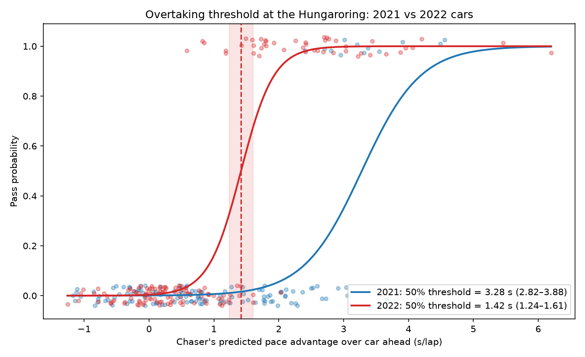

# Did the hard tyre cost Leclerc the 2022 Hungarian GP?

**Short answer: very likely yes.** Leclerc's hard tyres degraded about 3× faster than the field average. A lap-by-lap race simulation, using an overtaking threshold **measured from real race data rather than assumed**, puts him **P2–P4** on fresh mediums (central estimate **P2**) instead of his actual **P6**.


## Highlights

- **Tyre degradation model** built from real F1 timing data for all 20 drivers, with fuel correction, and **validated on unseen laps** against a no-wear baseline.
- **Measured how much faster a car must be to overtake** at the Hungaroring, from **285 close battles** in the 2021 and 2022 races, instead of guessing a number.
- **Showed that the 2022 ground-effect cars could overtake far more easily.** They needed a pace advantage of about **1.4 s/lap** to pass, compared with **3.3 s/lap** for the 2021 cars.
- **Lap-by-lap race simulator** that reproduces Leclerc's real finishing position to within 0.1 s, then replays the race with a different tyre choice.
- **Every key result is stress-tested**: fuel effect, overtaking difficulty and hold-out validation, with limitations stated openly.

Built in Python with [FastF1](https://github.com/theOehrly/Fast-F1), pandas, NumPy, SciPy, scikit-learn and Matplotlib.

## Key findings

- **Leclerc's hard stint degraded at 0.152 ± 0.044 s/lap (± 1 standard error), about 3× the field median on hards** (0.047 s/lap across 9 stints). On mediums and softs he was at or below the field median, so this wasn't a general pace or tyre-management problem. **The hard compound specifically didn't work for him.**
- **Fresh mediums would have been 7–20 s faster over the 15-lap stint**, depending on the assumed fuel effect. About 11 s of that comes from degradation alone and doesn't depend on the fuel assumption.
- **Overtaking in 2022 needed less than half the pace advantage it did in 2021:** **1.42 s/lap** (95% CI 1.24–1.61 s) against **3.28 s/lap** (95% CI 2.82–3.88 s).
- **At the measured 2022 threshold, Leclerc finishes P2–P4 instead of P6:** P2 at fuel effects of 0.055 and 0.08 s/lap, P4 at 0.03 s/lap. That's 2.7–15.1 s gained over the rest of the race.
- **The degradation model holds up on unseen data.** Fitted on the first 60% of each stint, it predicts the remaining laps with an RMS error of 0.78 s, against 1.02 s for a no-wear baseline. It beats the baseline in 73% of 55 stints.

## Measuring overtaking difficulty: 2021 vs 2022

A race simulation is only as good as its overtaking rule. A faster car can't just drive through the car ahead; it needs a big enough pace advantage to complete the pass. Rather than assume that number, this project **estimates it from historical race data.**

**How:**
1. Every green-flag lap where a car started within 1.0 s of the car ahead (with neither pitting) is treated as a **battle**: **285 battles** across the 2021 and 2022 Hungarian GPs.
2. For each battle, the chaser's **pace advantage** compares the car ahead's actual lap time with the chaser's **predicted clear-air pace** (what it would have lapped in free air). Using both cars' actual lap times would be circular, because a pass happens by definition when the chaser's lap beats the gap.
3. A **logistic regression** of pass/no-pass against pace advantage gives the **overtaking threshold**: the advantage at which a pass becomes 50% likely. Confidence intervals come from 1,000 bootstrap resamples.

**Result:**

| Race | Battles | Passes | Pass rate | Threshold (95% CI) |
|---|---|---|---|---|
| 2021 | 130 | 12 | 9% | 3.28 s/lap (2.82–3.88) |
| 2022 | 155 | 46 | 30% | **1.42 s/lap (1.24–1.61)** |



**Why the difference?** 2022 brought in **ground-effect cars**, which generate much of their downforce from the floor rather than the wings. That makes them far less sensitive to the turbulent "dirty air" behind another car, so they can follow closely through corners and set up a pass. The data is consistent with this: in 2022, a chasing car needed **less than half the pace advantage** to get by, and passes happened about 3× as often.

The measured 2022 threshold then feeds directly into the race simulation.

## Method

1. **Data:** lap times, tyre compound, tyre age and track status for all 20 drivers, from FastF1.
2. **Cleaning:** removed in-laps and out-laps, safety car / VSC / yellow-flag laps, laps more than 7% slower than the driver's best, and the final lap.
3. **Fuel correction:** cars get faster as fuel burns off, which masks tyre wear. Each lap is converted to an empty-tank equivalent using a fuel effect of 0.055 s/lap, and results are re-run from 0.03 to 0.08 s/lap.
4. **Degradation:** a linear fit of fuel-corrected lap time against tyre age for every stint, with the standard error of the slope.
5. **Strategy comparison:** Leclerc's hard stint compared with his own fresh-medium stint (stint 2) over the same tyre ages.
6. **Overtaking threshold:** measured from 2021–2022 battle data (see the section above).
7. **Race simulation:** rivals are replayed from real timing data, and Leclerc's laps 41–53 are adjusted by the modelled hard-vs-medium gap. He can only pass the car ahead if he is faster that lap by more than the overtaking threshold; otherwise he is held 0.5 s behind. Replaying the real strategy, the simulator reproduces his actual P6 to within 0.1 s.
8. **Validation:** each stint is split 60/40, the model is fitted on the first part and scored on the rest against a no-wear baseline.

## Figures

| Cleaned laps | Leclerc degradation |
|---|---|
|  |  |

| Field degradation | Hold-out validation |
|---|---|
|  |  |

## Limitations

- **Rivals don't react.** A faster Leclerc may have triggered strategy responses from Red Bull and Mercedes, so P2 is closer to a best case.
- **Degradation is modelled as linear**, so tyre "cliffs" aren't captured. This is why soft-tyre laps are predicted worst.
- **Leclerc's hard stint is short** (11 clean laps), hence the wide error bar on its degradation rate.
- **The two medium stints differ in base pace by 0.3–1.3 s**, likely due to traffic, so the fuel effect can't be calibrated from this race alone.
- **The overtaking comparison uses two races.** F1's live timing API stopped serving sessions that weren't already cached locally, which limited the data to 2021 and 2022. The 2021 race also had a wet, chaotic start, so not all of the difference can be put down to the new cars. The result is *consistent with* ground effect making overtaking easier, not proof of it.
- **Thresholds are probably slight overestimates.** A car being overtaken often loses time defending on that lap, which inflates the measured pace advantage on passing laps.
- **The simulation assumes** Ferrari had fresh mediums available and keeps the real pit-stop laps.

## Future work

- A non-linear (e.g. quadratic) degradation model to capture tyre cliffs
- Measure overtaking thresholds at other circuits and seasons as more data becomes available
- Apply the method to other contested strategy calls

## How to run

```bash
python3 -m venv .venv && source .venv/bin/activate
pip install -r requirements.txt

python deg_all_drivers.py      # field-wide degradation
python simulate_strategy.py    # hard vs medium comparison
python battles.py              # detect close battles and passes (2021–2022)
python fit_threshold.py        # fit the overtaking threshold
python race_sim.py 0.055       # race simulation (argument = fuel effect, s/lap)
python validate.py             # hold-out validation
```

Race data downloads automatically on the first run and is cached locally.

### Other scripts

| Script | Purpose |
|---|---|
| `check_data.py` | Loads and inspects the Hungary 2022 race data |
| `clean_laps.py` | Lap cleaning and filtering |
| `deg_model.py` | Leclerc's tyre degradation model |
| `sensitivity.py` | Fuel-effect sensitivity test |
